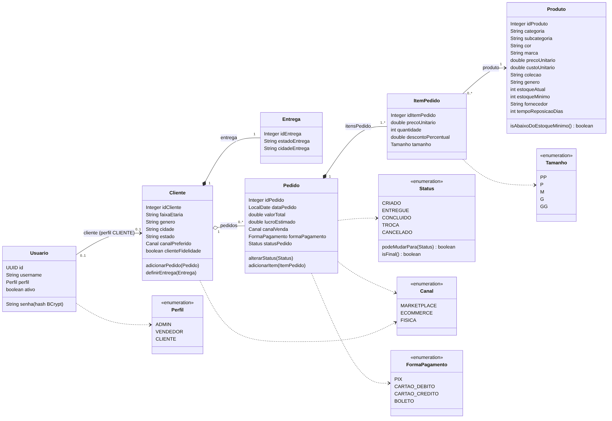
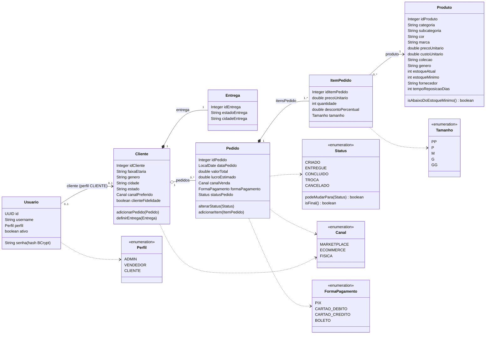
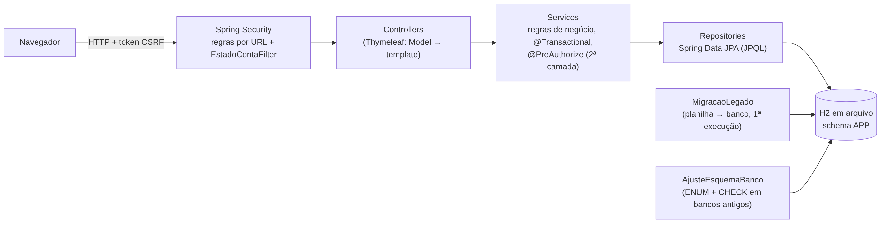

# Diagrama de classes da solução

O diagrama de domínio segue o UML da Entrega 1 (`UML/Vestuário.asta`, `UML/PNGDiagramaDeClasses.png`).
As mudanças desde lá são: o status **CRIADO** no enum `Status` (Entrega 3), a classe `Usuario` com
o enum `Perfil` (segurança) e a chave própria de `ItemPedido` (decisão D3).

Fonte Mermaid

## Associações JPA e lado proprietário

O **lado proprietário** é o que tem a chave estrangeira na tabela (o `@JoinColumn`). O outro lado usa
`mappedBy` e só espelha a associação em memória: alterar só o lado inverso não grava nada. Por isso
os métodos `Cliente.adicionarPedido`, `Cliente.definirEntrega` e `Pedido.adicionarItem` ajustam os dois lados.

| Associação | Proprietário (FK) | Lado inverso | Detalhes |
|---|---|---|---|
| Cliente 1 — 1 Entrega | `Entrega.cliente` (`id_cliente` UNIQUE) | `Cliente.entrega` (`mappedBy`) | composição: a entrega não existe sem o cliente |
| Cliente 1 — N Pedido | `Pedido.cliente` (`@ManyToOne(optional=false, LAZY)`) | `Cliente.pedidos` (`mappedBy`, cascade ALL, orphanRemoval) | |
| Pedido 1 — N ItemPedido | `ItemPedido.pedido` | `Pedido.itensPedido` (`mappedBy`, cascade ALL, orphanRemoval) | o item é gravado junto com o pedido |
| ItemPedido N — 1 Produto | `ItemPedido.produto` | — (unidirecional) | produto não precisa conhecer as vendas |
| Usuario 0..1 — 0..1 Cliente | `Usuario.cliente` (`id_cliente` UNIQUE) | — | só para o perfil CLIENTE |

## Responsabilidades

| Camada | Classes | Responsabilidade |
|---|---|---|
| Domínio (`model`) | `Produto`, `Cliente`, `Entrega`, `Pedido`, `ItemPedido`, `Usuario`, enums | estado e regras próprias: `Status.podeMudarPara`, `Pedido.alterarStatus`, `Produto.isAbaixoDoEstoqueMinimo` |
| Repositórios (`repository`) | `ProdutoRepository`, `ClienteRepository`, `PedidoRepository`, `ItemPedidoRepository`, `UsuarioRepository` | consultas JPQL, filtros, agregações do relatório, bloqueio pessimista |
| Serviços (`service`, `carrinho`, `cadastro`) | `ProdutoService`, `ClienteService`, `PedidoService`, `VendaService`, `EstoqueService`, `RelatorioService`, `UsuarioService`, `CarrinhoService`, `CadastroService`, validadores | regras de negócio, transações, `@PreAuthorize` |
| Web (`controller`) | um controller por área | recebe a requisição, chama o serviço, põe dados no `Model`, escolhe o template |
| Segurança (`config`, `security`) | `SecurityConfig`, `H2ConsoleSecurityConfig`, `EstadoContaFilter`, `PrincipalVestuario`, `UsuarioDetailsService` | login, perfis, regras por URL |
| Infra (`migracao`, `carga`, `config`) | `MigracaoLegado`, `CargaAutomatica`, `AjusteEsquemaBanco` | carga da planilha, primeiro ADMIN, ajuste do esquema |

## Arquitetura

