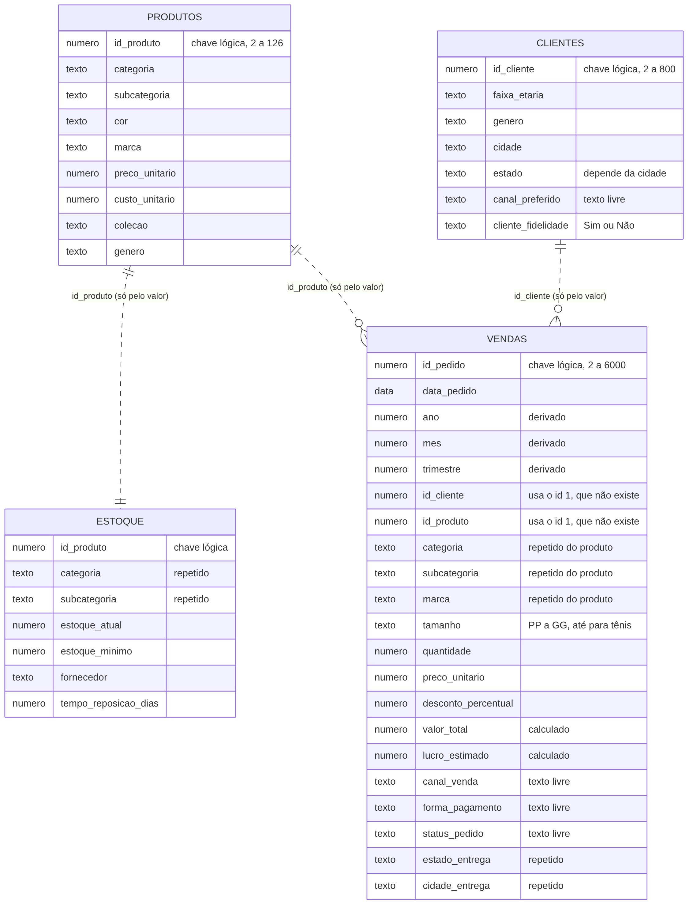
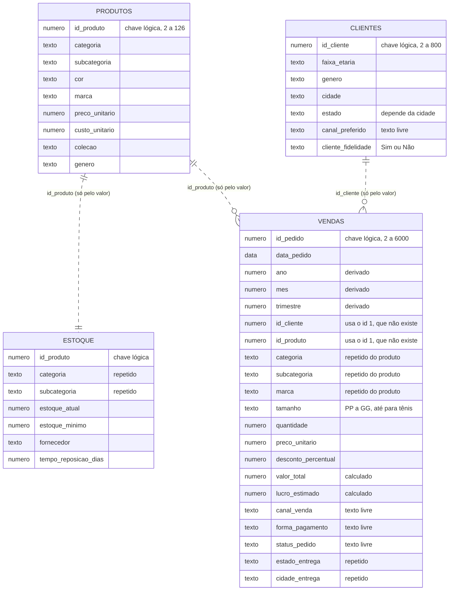
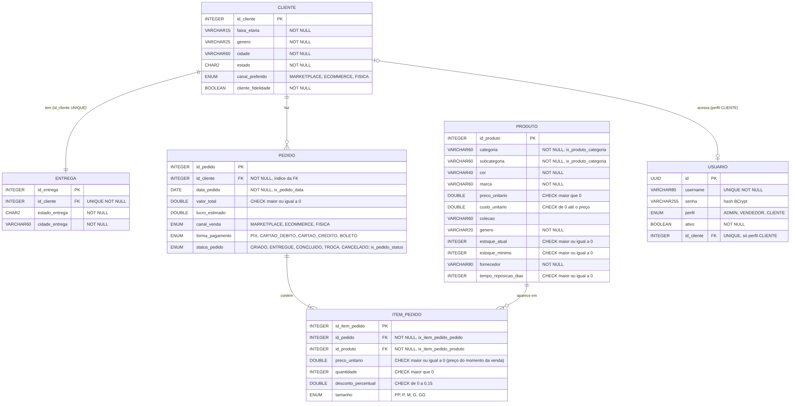
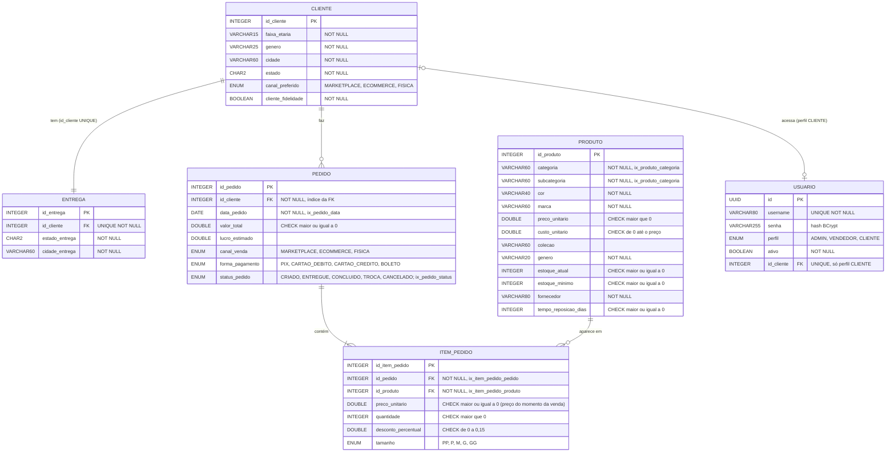

# Modelo relacional: legado e evoluído

## 1. Modelo legado (planilha)

A planilha tem 4 abas de dados (Produtos, Estoque, Clientes, Vendas) ligadas **só pelo valor dos
ids**: não há chave primária, chave estrangeira, tipo controlado nem índice (Entrega 1, seções 2.1 a 2.3).

Fonte Mermaid

## 2. Modelo evoluído (implementado)

Gerado pelo Hibernate a partir das entidades (`ddl-auto=update`, schema `APP`), mais as restrições
CHECK e o ajuste dos ENUM feitos por `config/AjusteEsquemaBanco`.

Fonte Mermaid

## 3. Do legado para o novo

| Legado | Novo | Problema resolvido |
|---|---|---|
| Produtos + Estoque (categoria e subcategoria repetidas) | `produto` (13 colunas) | P04 |
| Vendas: 1 linha = 1 pedido com 1 produto | `pedido` + `item_pedido` (N itens) | P03 |
| ano, mês, trimestre em Vendas | calculados na consulta (`year()`, `month()`) | P04 |
| categoria, subcategoria, marca em Vendas | lidas do produto pelo item | P04 |
| estado/cidade de entrega em cada venda | `entrega` (1 para 1 com o cliente) | P04 |
| preço da venda = preço atual | `item_pedido.preco_unitario` guarda o preço do momento | P06 |
| valor_total e lucro digitados | calculados pelo `VendaService`, CHECK `valor_total >= 0` | P05 |
| status, canal, pagamento, tamanho em texto livre | colunas ENUM do H2 (só aceitam os valores da lista) | P01, P07 |
| fidelidade "Sim"/"Não" | BOOLEAN | P01 |
| ids 1 usados sem existir | produto 1 e cliente 1 reconstruídos + FKs reais | P02 |
| — | `usuario` (login, perfis) | segurança (Entrega 3) |

## 4. Chaves

- **cliente, produto, pedido:** o id do legado é mantido (migração com `JdbcTemplate`); os novos
  registros recebem o próximo número (`IDENTITY`). Assim o pedido 4521 da planilha é o pedido 4521 do sistema.
- **item_pedido:** chave própria `id_item_pedido` (ver decisão D3 em `DECISOES_TECNICAS.md`).
- **entrega:** chave própria `id_entrega` + `id_cliente` **UNIQUE**, que garante 1 entrega por cliente.
- **usuario:** UUID (não é sequencial, não dá para adivinhar), `username` UNIQUE e `id_cliente` UNIQUE.

## 5. Restrições

| Tipo | Onde | Como |
|---|---|---|
| PK | todas as tabelas | `@Id` |
| FK | pedido→cliente, item_pedido→pedido, item_pedido→produto, entrega→cliente, usuario→cliente | `@ManyToOne` / `@OneToOne` + `@JoinColumn` |
| NOT NULL | campos obrigatórios | `@Column(nullable = false)`, `optional = false` |
| UNIQUE | `entrega.id_cliente`, `usuario.username`, `usuario.id_cliente` | `@JoinColumn(unique = true)`, `@Column(unique = true)` |
| Lista fixa | status, canal, pagamento, tamanho, perfil | `@Enumerated(STRING)` → coluna `ENUM(...)` no H2 |
| CHECK `ck_produto_preco` | produto | `preco_unitario > 0` |
| CHECK `ck_produto_custo` | produto | `custo_unitario >= 0 and custo_unitario <= preco_unitario` |
| CHECK `ck_produto_estoque` | produto | `estoque_atual >= 0 and estoque_minimo >= 0` |
| CHECK `ck_produto_reposicao` | produto | `tempo_reposicao_dias >= 0` |
| CHECK `ck_item_quantidade` | item_pedido | `quantidade > 0` |
| CHECK `ck_item_preco` | item_pedido | `preco_unitario >= 0` |
| CHECK `ck_item_desconto` | item_pedido | `desconto_percentual between 0 and 0.15` |
| CHECK `ck_pedido_valor` | pedido | `valor_total >= 0` |

Os CHECK são a última barreira: as mesmas regras já são conferidas antes, nos validadores Java
(`ProdutoValidator`, `ClienteValidator`) e nos services. O teste
`ConsultasIT.bancoRecusaDadosInvalidosMesmoSemPassarPeloJava` tenta gravar 7 valores inválidos direto por SQL e o banco recusa todos.

## 6. Índices

| Índice | Colunas | Por quê |
|---|---|---|
| `ix_pedido_data` | pedido(data_pedido) | filtro por período e ordenação da lista de pedidos, relatório por mês |
| `ix_pedido_status` | pedido(status_pedido) | filtro por status, relatório (exclui CANCELADO) |
| FK de pedido.id_cliente | pedido(id_cliente) | o H2 cria índice em toda FK; filtro "pedidos do cliente" |
| `ix_item_pedido_pedido` | item_pedido(id_pedido) | carregar os itens de um pedido |
| `ix_item_pedido_produto` | item_pedido(id_produto) | mais vendidos, relatório por categoria |
| `ix_produto_categoria` | produto(categoria, subcategoria) | ordem do catálogo e filtro por categoria |

Canal e forma de pagamento **não** têm índice: têm só 3 ou 4 valores e são usados junto com a
data, então o ganho seria pequeno (Entrega 1, seção 6.4).

## 7. Migração

`migracao/MigracaoLegado` roda ao iniciar, **só se o banco estiver vazio**, numa transação:

1. lê os CSV exportados da planilha (`src/main/resources/legado/`, UTF-8, `;`);
2. grava produtos (juntando Estoque), clientes, entregas, pedidos e itens com os ids do legado;
3. reconstrói o produto 1 e o cliente 1 (P02, decisão D12);
4. converte textos para enums e booleanos;
5. **confere os totais** (126 produtos, 800 clientes, 800 entregas, 5.999 pedidos, 5.999 itens,
   receita R$ 4.852.558,18 e lucro R$ 2.417.872,92). Se algo não bater, a transação é desfeita e nada fica gravado.

Evidência: `MigracaoLegadoIT` (banco de teste vazio, a migração roda e os totais conferem).
